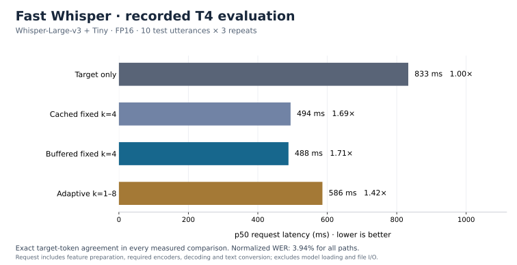

# Fast Whisper — GPU Inference Optimization

Whisper-Tiny drafts tokens and Whisper-Large-v3 verifies a block at a time.
This project measures drafting, target verification, cache rollback, token
processing and host–GPU control in autoregressive speech inference.

**Final validated result: 1.60× p50 request speedup and 2.00× decoder speedup on a
Tesla T4**, with exact target-token agreement and unchanged normalized WER.
The final evaluation covers 30 test utterances and three repeats, with an
additional untimed Hugging Face `generate()` oracle check. Buffered fixed k=4
with cached suppression masks is the default.

[Live benchmark showcase](https://fast-whisper-aarush.socialhill32.chatgpt.site)
· [Run audio inference in Colab](https://colab.research.google.com/github/AarushRathore1729/Simplismart_Assign/blob/main/notebooks/gpu_upgrade.ipynb)

The public showcase includes all 30 clip-level results, transcript comparisons,
raw report downloads and an illustrative draft–verify walkthrough. Live audio
inference runs in the GPU-backed Gradio notebook. [Website source](website).



## Final benchmark

Large-v3/Tiny, FP16, SDPA, batch size one; 30 evenly spaced utterances from
`hf-internal-testing/librispeech_asr_dummy` (`clean`, `validation`), one warmup
and three repeats. Measurement order is randomized.

| Path | p50 request | p95 request | Request speedup | Draft acceptance | Normalized WER |
|---|---:|---:|---:|---:|---:|
| Target-only cached greedy | 820 ms | 1794 ms | 1.00× | — | 3.22% |
| Buffered k=4 + cached masks | 512 ms | 1047 ms | 1.60× | 67.8% | 3.22% |

Decoder p50 fell from **656 to 328 ms**. All **90 optimized-vs-target token-digest
comparisons** passed; the independent Hugging Face oracle also passed on all 30
utterances. No outputs were truncated. Both paths achieved the same 3.22%
normalized WER.

This is a small, single-speaker test subset spanning three chapters. Quantiles
are descriptive across per-utterance repetition medians. Serial throughput is
not a concurrent-serving result, and the target-only timing baseline is the
project's cached greedy loop; `generate()` is an untimed correctness oracle.

[Final raw reports, audits and profile evidence](benchmarks/t4_20261013_final)
record source `1bed58a`. The [initial ten-utterance result](benchmarks/t4_20261013)
is retained separately. The datasets and conditions differ, so their latency
numbers are not a controlled mask-caching ablation.

## Quick start

Use a CUDA GPU. The tested T4 has 16 GB VRAM. The notebook preserves the
runtime's installed CUDA PyTorch and pins the tested Transformers release.

[Open GPU notebook in Colab](https://colab.research.google.com/github/AarushRathore1729/Simplismart_Assign/blob/main/notebooks/gpu_upgrade.ipynb)
· [Notebook source](notebooks/gpu_upgrade.ipynb) · [Decoder design](docs/design.md)

```bash
git clone --branch main --single-branch https://github.com/AarushRathore1729/Simplismart_Assign.git
cd Simplismart_Assign
python -m pip install -e '.[dev,benchmark,demo,api]' 'transformers==4.57.1'
python -m pytest
```

First run a two-clip smoke check:

```bash
specvoice-compare --audio audio1.wav audio2.wav --max-samples 2   --repetitions 1 --warmup-runs 1 --output results/gpu_smoke.json
```

Reproduce the final workload and audit the result:

```bash
specvoice-compare --max-samples 30 --sample-strategy evenly-spaced \
  --repetitions 3 --warmup-runs 1 --max-new-tokens 256 \
  --modes baseline optimized --cached-suppression --verify-generate \
  --output results/expanded.json
specvoice-audit results/expanded.json --output results/expanded.audit.json
```

## Demo and REST API

```bash
specvoice-demo --port 7860
specvoice-serve --port 8000
```

Launch the desired interface. The demo accepts an English audio upload, displays
matching target/fixed-draft transcripts, compares all four paths and exports the
measured result. Open forwarded port 7860 in Lightning AI; the notebook also
supports an inline Gradio demo. `--share` explicitly enables a temporary public
Gradio link. See the [one-minute demo guide](docs/demo.md).

The REST API loads one engine and provides `POST /transcribe`, `GET /health`
and `/docs`, with JSON text, tokens and component timings.

```bash
curl -X POST 'http://127.0.0.1:8000/transcribe?mode=optimized&max_new_tokens=128'   -F 'file=@audio1.wav'
```

## Implementations

| Mode | What it does |
|---|---|
| `baseline` | Target-only greedy decoding with persistent KV state |
| `speculative` | Existing cached fixed-k draft/verify decoder |
| `optimized` | Preallocated token workspaces, device-side ID mapping and deferred draft-cache catch-up |
| `adaptive` | Buffered decoder with acceptance-based k adjustment and target-only fallback |

Rejection commits the accepted prefix plus the target correction and crops only
self-attention KV state. Fully accepted blocks consume the two uncached draft
inputs together on the next iteration. Draft proposals stay on device; one small
acceptance/EOS packet is transferred per verification block. Transformers still
manages dynamic KV allocations. Implementation: Python, PyTorch SDPA/CUDA,
PyTorch Profiler and NVTX.

## Profiling result

On the same 23-generated-token clip, the final traces show `aten::isin` and
`aten::_unique` calls each falling from 90 to zero after mask caching. Both
profiles have identical output tokens, five target calls and 20 draft calls.
Recorded `cudaLaunchKernel` runtime calls fall from 8,427 to 6,578 (21.9%);
`cuLaunchKernel` driver calls remain at 1,354. Instrumented timing is excluded
from the headline request benchmark.

Cached masks are enabled for buffered paths by default. Use
`--no-cached-suppression` for the original four-path ablation:

```bash
specvoice-compare --modes baseline speculative optimized adaptive \
  --max-samples 10 --repetitions 3 --max-new-tokens 128 \
  --no-cached-suppression --output results/uncached.json
```

The target-only oracle continues using the original Hugging Face suppression
processors. Timestamp rules retain the original adapter.

## Measurement and validation

- Request latency includes resampling, feature preparation, required encoders,
  decoding and text conversion. It excludes model loading, file I/O and oracle checks.
- Component encoder/decoder times are synchronized CUDA measurements. Serial
  throughput and peak allocated CUDA memory are recorded separately.
- Both models are resident in every path; memory is not a target-only deployment
  comparison. CUDA stream spans can include host launch gaps.
- Profiling runs separately and exports `.trace.json`, `.profile.txt` and
  `.stages.json`, with ranges for draft, verification, control, cache and fallback.
- Every measured run requires exact tokens against the target decoder. New
  reports include per-run token digests and recomputable summary metrics.
- 84 tests cover cache-sensitive rejection, EOS, budget limits, actual Transformers
  cache objects, suppression equivalence, uploaded audio, REST responses and audit failures.

An additional `--verify-generate` check compares the target path with Hugging Face
`generate()` outside timing. A numerical token mismatch stops publication of
speedup evidence and saves the discrepancy. [Validation record](docs/validation.md).

Scope: greedy English transcription, batch size one, audio up to 30 seconds.

## Repository map

- `src/specvoice/asr/`: decoders, cache rollback, Whisper policy and transcription.
- `src/specvoice/compare.py`, `audit.py`: measured comparison and result verification.
- `src/specvoice/demo.py`, `web_api.py`: upload demonstration and REST interface.
- `notebooks/gpu_upgrade.ipynb`: Colab/Lightning execution and evidence export.
- `benchmarks/`: committed measured evidence with source and hardware provenance.
- `scripts/render_benchmark.py`: reproducible SVG/PNG benchmark figure.
- `tests/`: offline correctness, API and benchmark validation.

The original assignment remains under `fast_whisper/`; its [historical README](docs/legacy_assignment.md)
and sampling results are a separate implementation. Use the `specvoice-*` commands
for the verified greedy inference project.
