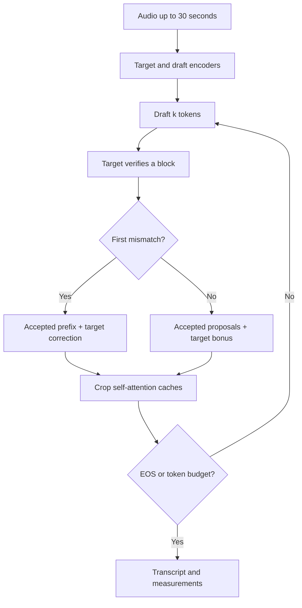

# Decoder design

The target model defines the output. The draft proposes work that can be checked
in a single target forward pass. English transcription uses a shared language,
task and token-suppression policy; neither path samples tokens.

## The cache invariant

Between verification blocks, the target cache contains every committed token
except the last one. That last token is the next target input. On rejection,
only the matching draft prefix and the target correction are committed; the
tentative self-attention cache is cropped to committed length minus one.
The encoder cross-attention keys and values remain intact.

The draft cache can be one token shorter after a fully accepted block. Rather
than making an extra forward call solely to catch up, the next draft call
consumes the final accepted proposal and the target bonus together. Cache-sensitive
tests verify this behavior using predictions that depend on the full history.

## Buffered control

Token and verification workspaces are allocated once per decode. Drafting does
not call `.item()` on each proposal. The verifier computes the first mismatch,
committed length and first EOS on device, then transfers one small control
packet per block. Transformers still allocates dynamic KV tensors.

Whisper-Large-v3 and Tiny do not have identical token-ID spaces. Startup builds
semantic mapping tables, including the renamed no-speech token. A target-only
token can condition the draft with its EOS token, but target verification still
determines every committed output token.

## Scheduling and the measured tradeoff

Fixed drafting uses k=4. The adaptive heuristic starts at four, grows after high
acceptance, halves k after low acceptance and permanently switches to target-only
after three low-acceptance blocks. All state resets for each utterance.

The initial T4 evaluation found fixed drafting faster. The adaptive fallback
reduced useful batching on a long clip and added 51 target-only steps in each
repeat. Lower draft work therefore did not imply lower total latency. Fixed
drafting is the default; adaptive remains an explicit experimental comparison.

## Profile-guided mask caching

The recorded PyTorch profile showed 112 `aten::isin` calls, associated `arange`,
`unique` and sort work. Transformers 4.57.1 reconstructs suppression masks on
each processor call. `--cached-suppression` builds global and first-position
boolean masks once, then applies `masked_fill`. The target-only oracle keeps
the original Hugging Face processors. Exact score-equivalence tests cover first
and later positions in FP32 and FP16.

Cached masks are now the default for buffered paths after the final T4 run
passed the 30-utterance Hugging Face oracle and all 90 token-digest comparisons.
The same profiled 23-token clip eliminates all 90 isin and unique calls without
changing tokens or model-forward counts. Timestamp constraints retain the original
adapter. Use --no-cached-suppression for an uncached ablation.

## Measurement boundaries

Request time includes waveform resampling, feature preparation, required encoders,
decoding and text conversion. File I/O, model loading and oracle checks are outside
that measurement. Stage boundaries synchronize CUDA. The profiler runs separately
because instrumentation changes timing; event spans may include host launch gaps.

Each measured run checks exact tokens against the target decoder. New reports
also store SHA-256 digests of token IDs, outside the latency measurement, so the
audit command can compare per-run evidence without storing all token sequences.

The REST API loads one engine and serializes inference through a lock. Its upload
endpoint runs in FastAPI's thread pool. Benchmarks remain batch size one and do
not establish concurrent-serving throughput.
